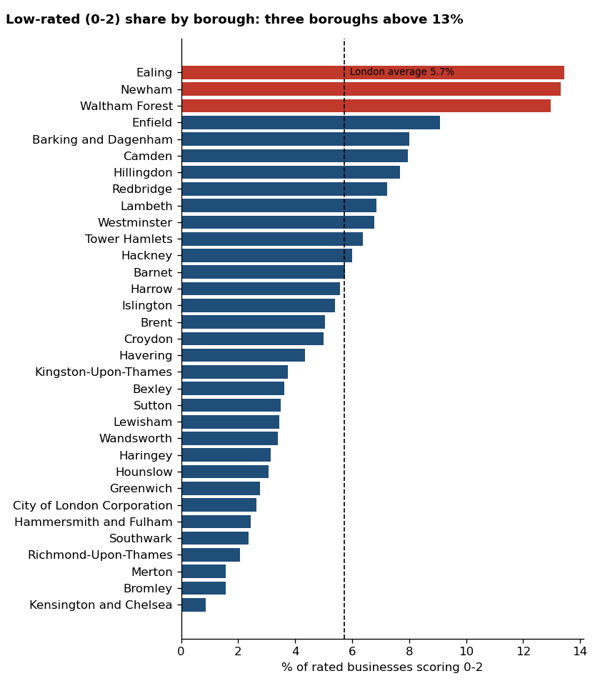
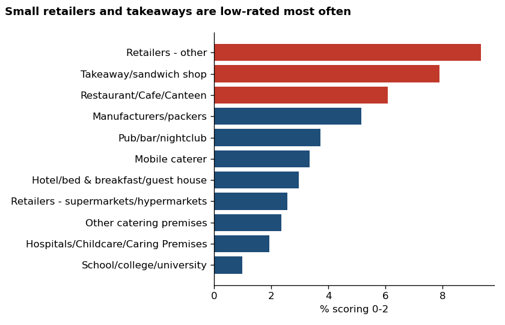

# London Food Hygiene Ratings: where is the risk?

**Result:** 5.7% of London's 71,741 rated food businesses score 0-2. In Ealing (13.4%), Newham and Waltham Forest the share is more than double the London average, and 15 times higher than in Kensington and Chelsea (0.9%).



## The question
Which London boroughs and types of food business are most likely to have poor hygiene ratings, and are councils keeping up with inspections? This is the kind of question a council environmental health team or a food delivery platform's compliance team would ask.

## The data
- **Source:** [Food Standards Agency, Food Hygiene Rating Scheme open data](https://ratings.food.gov.uk/open-data), all 33 London local authorities
- **Extracted:** 18 November 2026
- **Size:** 81,764 businesses, 71,741 with a 0-5 rating (the rest are exempt or awaiting inspection)

## What I did
1. **Extracted and cleaned** 33 XML files with Python ([`scripts/01_extract_clean.py`](scripts/01_extract_clean.py)): parsed the XML, standardised postcodes, converted dates and scores, separated "awaiting inspection" and "exempt" businesses from rated ones, and created a low-rating flag and a years-since-inspection field.
2. **Analysed in SQL** ([`sql/analysis_queries.sql`](sql/analysis_queries.sql), SQLite): seven queries using `GROUP BY`, `CASE`, `HAVING` and window functions (`RANK`, `SUM() OVER`). Results are in [`sql/query_results.txt`](sql/query_results.txt).
3. **Explored and visualised in Python** ([notebook](notebooks/london_food_hygiene_analysis.ipynb)) with pandas and Matplotlib.
4. **Built an interactive dashboard** in Power BI / Tableau (see [`dashboard/`](dashboard/)).

## Key findings
| # | Finding |
|---|---|
| 1 | **Most businesses are safe:** 68.6% score the top rating of 5. |
| 2 | **Risk is concentrated:** Ealing 13.4%, Newham 13.3% and Waltham Forest 13.0% low-rated, against a London average of 5.7%. |
| 3 | **Sector matters:** small retailers (9.3%) and takeaways (7.9%) are low-rated far more often than schools (1.0%) or supermarkets (2.6%). |
| 4 | **Management drives the worst ratings:** businesses rated 0 score worst on *confidence in management* (25.2), ahead of structural (20.3) and hygiene (18.5). |
| 5 | **Inspection backlog:** 19.2% of Camden's food businesses are still awaiting their first inspection. |

A note on interpretation: recently inspected businesses have *lower* average ratings. That is not because standards are falling. Councils re-inspect poorly rated businesses sooner, so an old inspection date usually means a good rating last time.



## Recommendation
Boroughs that combine a high low-rated share with a large backlog (Ealing, Camden) should prioritise first inspections of new takeaways and small retailers. Advice visits should focus on food safety management, the area that most separates 0-rated businesses from the rest.

## Repository structure
| Path | Contents |
|---|---|
| `data/london_food_hygiene_clean.csv` | Cleaned dataset (one row per business) |
| `scripts/` | Python extraction/cleaning and SQLite loading scripts |
| `sql/` | Analysis queries and their results |
| `notebooks/` | Jupyter notebook with charts |
| `images/` | Charts used in this README |
| `dashboard/` | Power BI / Tableau dashboard file and screenshot |

## How to reproduce
```bash
pip install pandas matplotlib
# download the London XML files from https://ratings.food.gov.uk/open-data into a folder, then:
python scripts/01_extract_clean.py <folder with XML files>
python scripts/02_load_sqlite.py
```

## Tools
Python (pandas, Matplotlib, ElementTree) · SQL (SQLite) · Power BI / Tableau · Jupyter

*Data: Food Standards Agency, used under the Open Government Licence.*
